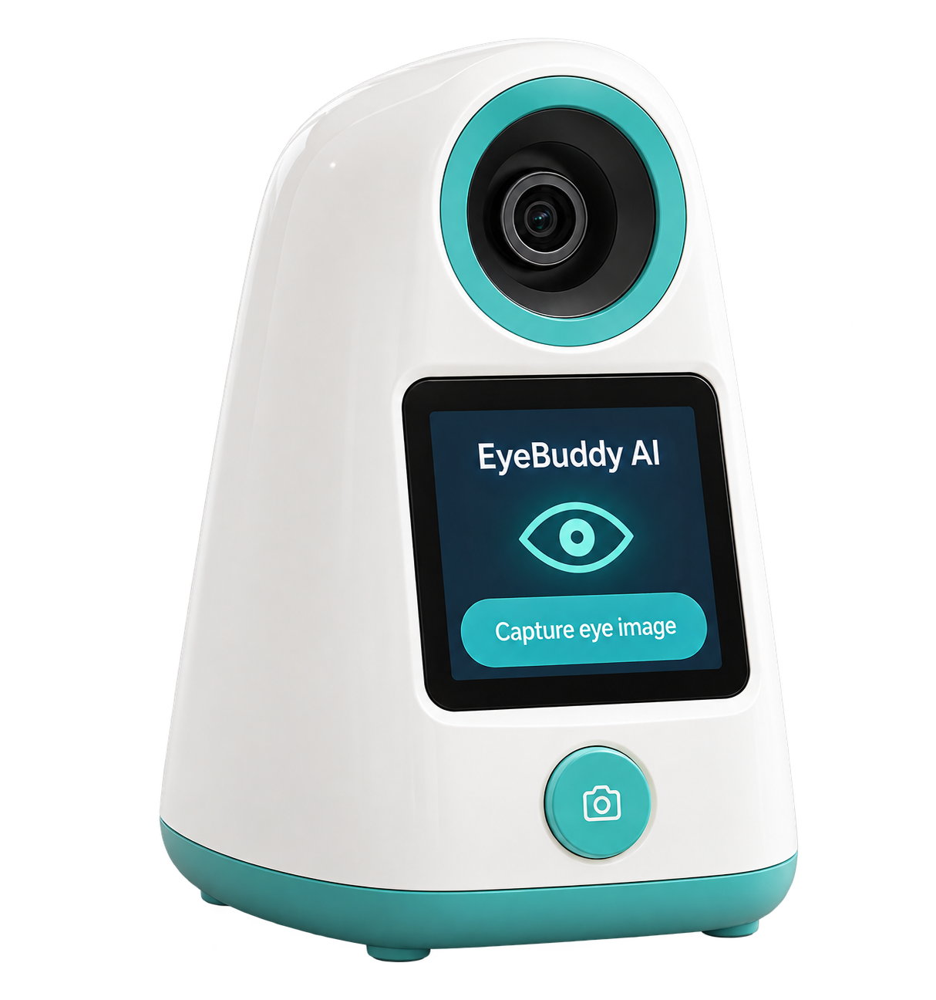
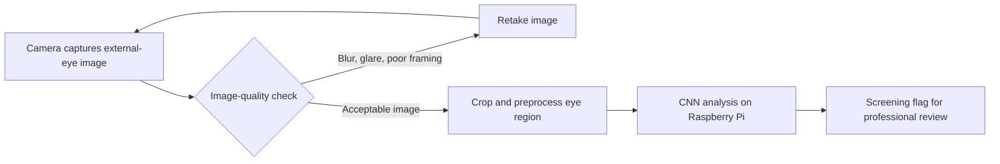

# EyeBuddy — AI Eye Screening Concept

EyeBuddy is a proposed desktop device combining a camera, a Raspberry Pi, and a convolutional neural network (CNN) to study screening of visible external-eye abnormalities that may warrant professional review.

**Status: concept and presentation materials. No physical device, trained clinical model, or validated diagnostic performance is included.**

## Watch the project presentation

[Download or watch the Thai presentation video](EyeBuddy-presentation.mp4).

The video combines a presenter/avatar, concept illustrations, Thai topic captions, and a worldwide research statistic. Its graphics and example result are illustrative.

## Proposed workflow

## Proposed hardware

- Raspberry Pi 5 with cooling, suitable power supply, and storage.
- Autofocus camera; evaluate focus distance and image detail before choosing final optics.
- Camera mount to make framing reproducible.
- Controlled diffuse illumination, subject to appropriate eye-safety assessment.
- Capture button and display.
- Desktop enclosure.

The circuit board and device illustrations are concepts, not verified mechanical or electrical designs. A CNN accelerator is optional and would depend on measured model performance and runtime compatibility.

## AI development plan

1. Select a narrow clinical target with an eye-care professional.
2. Obtain consented, legally usable images with clinician-confirmed labels, including similar-looking noninfectious conditions.
3. Build and evaluate image-quality checks.
4. Train a lightweight CNN on a development computer; deploy inference to the Pi only after validation.
5. Split data by patient, then assess performance across cameras, lighting, and demographic groups.
6. Measure false negatives, false positives, uncertainty, runtime, and the need for referral.

Transformer-based models are an optional research direction, not an implemented component. An image alone does not necessarily identify an infectious cause.

## Worldwide research context

WHO's *Trachoma* fact sheet, updated July 2026, reports approximately **1.9 million people with blindness or visual impairment attributable to trachoma**.

This is **not** the worldwide number of current eye infections, **not** an annual conjunctivitis count, and **not** evidence that this proposed device can detect trachoma.

[WHO source](https://www.who.int/news-room/fact-sheets/detail/trachoma) · [Research notes](research.md)

## เอกสารภาษาไทย

EyeBuddy เป็นแนวคิดอุปกรณ์คัดกรองดวงตาเบื้องต้นด้วยกล้อง Raspberry Pi และ AI เพื่อศึกษาสัญญาณผิดปกติที่ควรได้รับการตรวจเพิ่มเติม ขณะนี้ยังไม่ได้สร้างอุปกรณ์จริงหรือยืนยันความแม่นยำทางคลินิก

[บทพูดภาษาไทย](thai-script.md) · [รายละเอียดต้นแบบ](prototype-plan.md)

## Privacy and intended use

The proposed design should request consent before capture, process images locally where practical, and provide deletion controls. Screening results must not imply that an infection is confirmed or that eye disease has been ruled out. This project is educational concept material, not a medical diagnosis or treatment tool.

## Repository contents

- `eyebuddy-concept.png`: AI-generated device concept artwork.
- `EyeBuddy-presentation.mp4`: edited project presentation.
- Markdown documents: research, Thai script, and prototype plan.

No private training dataset, raw camera capture, authentication credentials, or unrelated workspace materials are included.

## Share this project

Repository: https://github.com/whitepig2929-arch/eyebuddy-ai
